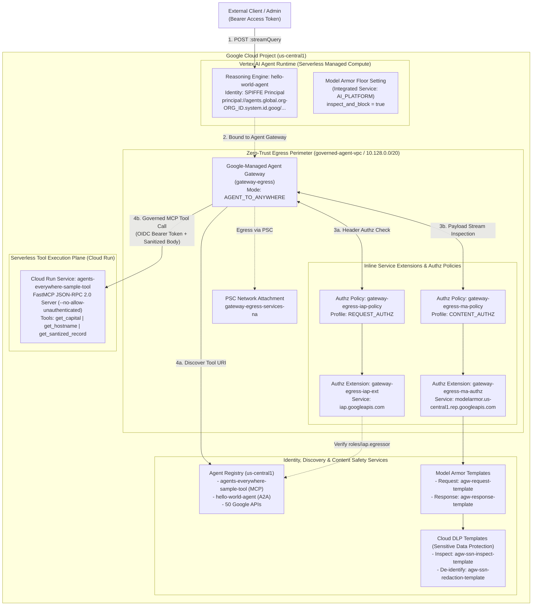
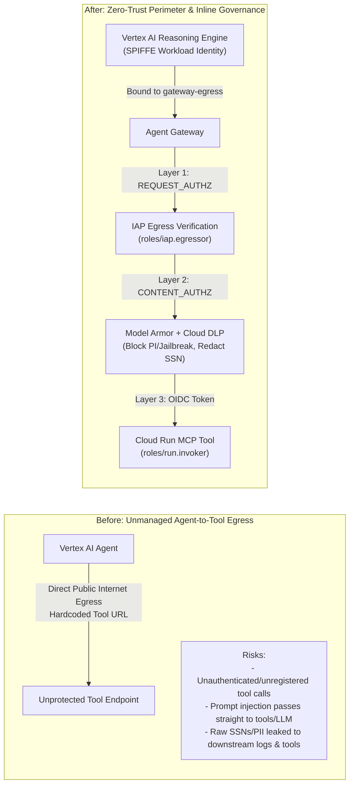

# High-Level Design (HLD) — Secure AI Agents: Zero-Trust Perimeters and Inline Governance (`L400-APEX-004`)

> **Lab URL:** [https://explore.qwiklabs.com/classrooms/21504/labs/115875](https://explore.qwiklabs.com/classrooms/21504/labs/115875)  
> **Lab Code:** `L400-APEX-004` (`[FDE]: Secure AI Agents: Zero-Trust Perimeters and Inline Governance`)

---

## 1. Executive Summary & Architectural Vision

Generative AI agents are evolving from passive conversational interfaces into autonomous systems that discover, authenticate to, and invoke remote enterprise tools over the **Model Context Protocol (MCP)**. Traditional perimeter-only network firewalls cannot govern dynamic agent-to-tool workflows because:
1. Tool endpoints are discovered dynamically at runtime via service registries.
2. Agent identities use federated SPIFFE workload principals rather than static IP addresses.
3. Application payloads contain natural-language prompts and unstructured tool outputs susceptible to **Prompt Injection / Jailbreak attacks** and **Sensitive Data / PII Leakage**.

This architecture establishes a **Zero-Trust Execution Perimeter and Inline Content Governance** framework on Google Cloud by combining four foundational pillars:

1. **Private Network Perimeter & Egress Control**: A custom VPC (`governed-agent-vpc`), regional private subnet (`agent-private-subnet`), Private Service Connect (PSC) network attachments (`gateway-egress-na`, `gateway-egress-services-na`), and a Google-managed regional **Agent Gateway** (`gateway-egress`, `AGENT_TO_ANYWHERE`) that intercepts all outbound agent-to-tool and agent-to-API traffic.
2. **Centralized Service Discovery (`Agent Registry`)**: Both the Vertex AI Agent Runtime (`hello-world-agent`) and the serverless Cloud Run MCP tool (`agents-everywhere-sample-tool`)—along with 50+ regional/global Google API endpoints—are registered in the regional **Agent Registry** (`agentregistry.googleapis.com`).
3. **Zero-Trust Egress Authorization (`IAP` + `REQUEST_AUTHZ`)**: Outbound tool calls from the Agent Runtime must pass through an **Identity-Aware Proxy (IAP)** Service Extension (`gateway-egress-iap-ext`) bound to the Agent Gateway via a `REQUEST_AUTHZ` policy (`gateway-egress-iap-policy`), verifying both `roles/iap.egressor` on the Agent Registry MCP server resource and OIDC identity tokens (`roles/run.invoker`) on Cloud Run.
4. **Inline Content Safety & DLP De-identification (`Model Armor` + `CONTENT_AUTHZ`)**: Request and response bodies traversing the Agent Gateway are streamed through a regional **Model Armor** Service Extension (`gateway-egress-ma-authz`) bound via a `CONTENT_AUTHZ` policy (`gateway-egress-ma-policy`), enforcing real-time **Prompt Injection / Jailbreak blocking** (`HTTP 403 / 799`) and **Cloud DLP SSN Redaction** (`[US_SOCIAL_SECURITY_NUMBER]`).

---

## 2. High-Level Architecture Diagram

---

## 3. OSI 7-Layer Model Mapping for Agent Governance

The lab architecture enforces defense-in-depth across layers 3 through 7 of the OSI model:

| OSI Layer | Layer Name | Google Cloud Component | Security & Governance Enforcement |
| :--- | :--- | :--- | :--- |
| **Layer 7** | **Application Content & Semantics** | **Model Armor (`CONTENT_AUTHZ`) + Cloud DLP** | Inspects JSON-RPC 2.0 MCP request/response bodies inline for Prompt Injection, Jailbreaks, Hate Speech, Harassment, Dangerous Content, Malicious URIs, and de-identifies PII (`US_SOCIAL_SECURITY_NUMBER`, `CREDIT_CARD_NUMBER`, `PHONE_NUMBER`, `EMAIL_ADDRESS`). |
| **Layer 7** | **Application Protocol & Discovery** | **Agent Registry + FastMCP (`JSON-RPC 2.0`)** | Enforces canonical endpoint discovery (`/mcpServers` and `/services`) so agents only connect to registered, administrator-approved MCP tools and Google APIs. |
| **Layer 6 / 7** | **Identity & Session Presentation** | **Identity-Aware Proxy (`REQUEST_AUTHZ`) + OIDC / SPIFFE** | Validates Workload Identity SPIFFE principals (`principal://agents.global.org-<ORG_ID>.system.id.goog/...`) against IAP Egress policies (`roles/iap.egressor`) and verifies OIDC tokens against Cloud Run IAM (`roles/run.invoker`). |
| **Layer 4 / 5** | **Transport & Proxy Interception** | **Agent Gateway (`gateway-egress`)** | Google-managed regional egress proxy (`AGENT_TO_ANYWHERE`) bound directly to the Reasoning Engine (`--agent-gateway`), terminating and inspecting outbound TLS/HTTP streams. |
| **Layer 3** | **Network Perimeter** | **Custom VPC + Private Subnet + PSC Network Attachments** | Isolates network egress within `governed-agent-vpc` (`10.128.0.0/20`) via Private Service Connect (`gateway-egress-na` and `gateway-egress-services-na`). |

---

## 4. Before vs. After Security Posture Transformation

| Security Dimension | Unmanaged State (Baseline) | Phase 1: Base Infrastructure (Tasks 2–3) | Phase 2: Zero-Trust Access Control (Tasks 4–5) | Phase 3: Inline Content Safety (Tasks 6–7) |
| :--- | :--- | :--- | :--- | :--- |
| **Network Egress** | Unfettered public egress | Routed via `gateway-egress` & PSC | Routed via `gateway-egress` & PSC | Routed via `gateway-egress` & PSC |
| **Service Discovery** | Static URLs in env/code | Dynamic lookup in **Agent Registry** | Dynamic lookup in **Agent Registry** | Dynamic lookup in **Agent Registry** |
| **IAP Gateway Policy** | None | `DRY_RUN` mode (`enable_iap_enforcement = false`) | **Enforced** (`enable_iap_enforcement = true`, `roles/iap.egressor` required) | **Enforced** (`enable_iap_enforcement = true`) |
| **Cloud Run Auth** | Public or unmanaged | `--no-allow-unauthenticated` | Verified OIDC Token via `roles/run.invoker` + `roles/iam.serviceAccountTokenCreator` | Verified OIDC Token |
| **Prompt Injection & Jailbreak** | Vulnerable | Unfiltered | Unfiltered | **Blocked Inline** at Gateway & Vertex AI Floor (`HTTP 403 / 799`) |
| **Sensitive Data (SSN/PII)** | Leaked in plaintext | Leaked in plaintext | Leaked in plaintext | **Redacted Inline** via DLP De-identify Template (`[US_SOCIAL_SECURITY_NUMBER]`) |

---

## 5. Core Component Responsibilities

### 5.1 Networking & Gateway Layer (`terraform/networking` & `terraform/gateway`)
- **VPC (`governed-agent-vpc`) & Subnet (`agent-private-subnet`)**: Provides a regional `10.128.0.0/20` RFC 1918 address space in `us-central1` with `auto_create_subnetworks = false`.
- **PSC Network Attachments (`gateway-egress-na`, `gateway-egress-services-na`)**: Enable automatic Private Service Connect (`ACCEPT_AUTOMATIC`) bridging between Google-managed tenant infrastructure (Agent Gateway) and the consumer VPC.
- **Agent Gateway (`gateway-egress`)**: Configured with `governed_access_path = "AGENT_TO_ANYWHERE"` and linked to `//agentregistry.googleapis.com/projects/${PROJECT_ID}/locations/${REGION}`.

### 5.2 Identity & Registry Layer (`terraform/registry` & Task 3/4 CLI)
- **Agent Registry (`agentregistry.googleapis.com`)**: Maintains the authoritative inventory of allowed destinations:
  - 10 core Google APIs × 5 endpoint variants (`global`, `mtls`, `locational`, `locational-mtls`, `rep`) = **50 Google API service registrations**.
  - `agents-everywhere-sample-tool`: Registered with `--endpoint-spec-type=mcp-server-spec` pointing to the Cloud Run HTTPS URL.
  - `hello-world-agent`: Registered with `--endpoint-spec-type=a2a-agent-card` pointing to the Vertex AI Reasoning Engine `:streamQuery` URL.
- **Identity-Aware Proxy (`iap.googleapis.com`)**: Evaluates outbound requests from the Reasoning Engine against IAM policies bound to both the regional `agent-registry` namespace and the specific registered MCP Server (`agentregistry-00000000-0000-0000-...`).

### 5.3 Content Safety Layer (`terraform/model-armor`)
- **Cloud DLP Templates**:
  - `agw-ssn-inspect-template`: Scans for `US_SOCIAL_SECURITY_NUMBER`, `CREDIT_CARD_NUMBER`, `PHONE_NUMBER`, and `EMAIL_ADDRESS` at `min_likelihood = "POSSIBLE"`.
  - `agw-ssn-redaction-template`: Replaces detected PII infoTypes inline with their infoType tag (e.g., `[US_SOCIAL_SECURITY_NUMBER]`).
- **Model Armor Templates (`agw-request-template`, `agw-response-template`)**:
  - Combine Responsible AI filters (`HATE_SPEECH`, `HARASSMENT`, `SEXUALLY_EXPLICIT`, `DANGEROUS` at `MEDIUM_AND_ABOVE`), Prompt Injection & Jailbreak detection (`ENABLED` at `MEDIUM_AND_ABOVE`), Malicious URI detection (`ENABLED`), and Advanced SDP (DLP inspect + de-identify templates).
- **Vertex AI Floor Setting (`vertex_ai_floor_setting`)**:
  - Enforces project-wide baseline protection for `AI_PLATFORM` with `inspect_and_block = true`.
