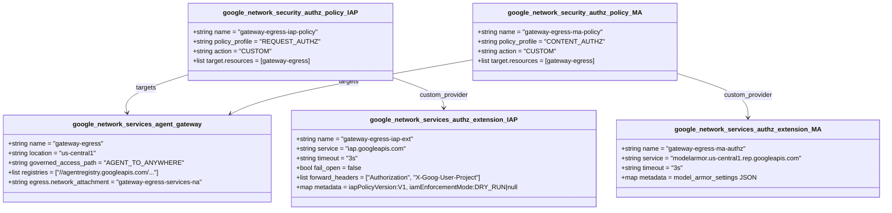
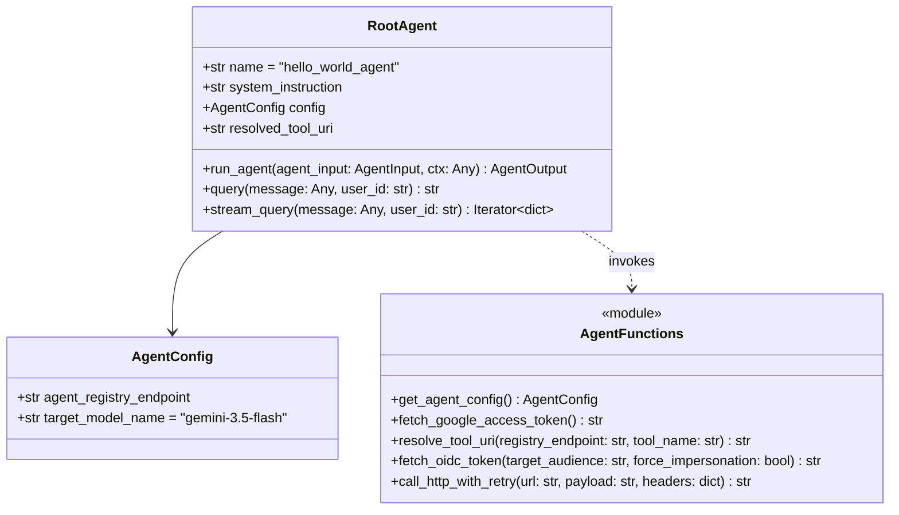

# Low-Level Design (LLD) — Secure AI Agents: Zero-Trust Perimeters and Inline Governance (`L400-APEX-004`)

> **Lab URL:** [https://explore.qwiklabs.com/classrooms/21504/labs/115875](https://explore.qwiklabs.com/classrooms/21504/labs/115875)  
> **Lab Code:** `L400-APEX-004` (`[FDE]: Secure AI Agents: Zero-Trust Perimeters and Inline Governance`)

---

## 1. Repository & Module Layout

```text
.
├── agents/
│   └── hello_agent/
│       ├── agents-cli-manifest.yaml       # Google Agents CLI (v0.6.1) manifest
│       ├── Dockerfile                     # Container spec for local/runtime builds
│       ├── pyproject.toml                 # Dependencies (google-adk, google-cloud-aiplatform, pydantic)
│       ├── requirements.txt               # Locked runtime dependencies
│       └── app/
│           ├── agent.py                   # RootAgent, resolve_tool_uri(), fetch_oidc_token(), call_http_with_retry()
│           ├── agent_runtime_app.py       # Vertex AI ReasoningEngine entrypoint wrapper
│           ├── main.py                    # Local HTTP entrypoint
│           └── models.py                  # Pydantic JSON-RPC 2.0 & Agent state models
├── mcp-servers/
│   └── sample-tool/
│       ├── Dockerfile                     # Cloud Run container build (python:3.11-slim, port 8080)
│       ├── models.py                      # JSON-RPC 2.0 request/response Pydantic schemas
│       ├── pyproject.toml                 # FastMCP & Pydantic dependencies
│       ├── requirements.txt               # Runtime dependencies
│       └── server.py                      # FastMCP server exposing get_capital, get_hostname, get_santized_record
├── scripts/
│   └── lab-cleanup.sh                     # Ordered teardown of Reasoning Engine, Authz Policies, and Agent Gateway
└── terraform/
    ├── main.tf                            # Root orchestrator, Artifact Registry, & core IAM bindings
    ├── networking/                        # VPC, Subnet (10.128.0.0/20), and PSC Network Attachment
    ├── registry/                          # Agent Registry API enablement, IAP egressor bindings, & 50 Google APIs
    ├── gateway/                           # Agent Gateway, IAP REQUEST_AUTHZ extension/policy, Model Armor CONTENT_AUTHZ
    └── model-armor/                       # DLP Inspect/De-identify templates, Model Armor templates, & Floor Settings
```

---

## 2. Terraform Infrastructure Modules Specification

### 2.1 Root Module (`terraform/main.tf`)

| Resource / Module | Type | Resource Name / Target | Purpose |
| :--- | :--- | :--- | :--- |
| `module.networking` | Module | `./networking` | Provisions `governed-agent-vpc`, `agent-private-subnet`, and `gateway-egress-na`. |
| `module.registry` | Module | `./registry` | Enables `agentregistry.googleapis.com`, binds `roles/iap.egressor` on the registry, and registers 50 Google API endpoints. |
| `module.gateway` | Module | `./gateway` | Deploys `gateway-egress`, `gateway-egress-iap-ext`, `gateway-egress-iap-policy`, and (when `enable_model_armor=true`) `gateway-egress-ma-authz` & `gateway-egress-ma-policy`. |
| `module.model_armor` | Module | `./model-armor` | Provisions DLP templates, Model Armor templates, Floor Settings, and Service Extensions IAM when `enable_model_armor=true`. |
| `google_artifact_registry_repository.agent_repo` | Resource | `agent-repo` (`DOCKER`) | Stores container images in `us-central1` for Cloud Run (`agents-everywhere-sample-tool`). |
| `google_project_iam_member.aiplatform_network_admin` | Resource | `roles/compute.networkAdmin` | Allows `service-PROJECT_NUMBER@gcp-sa-aiplatform.iam.gserviceaccount.com` to attach PSC interfaces. |
| `google_project_iam_member.aiplatform_re_network_admin` | Resource | `roles/compute.networkAdmin` | Allows `service-PROJECT_NUMBER@gcp-sa-aiplatform-re.iam.gserviceaccount.com` to manage Reasoning Engine network attachments. |
| `google_project_iam_member.agent_identity_agentregistry_viewer` | Resource | `roles/agentregistry.viewer` | Grants the SPIFFE `principalSet` permission to query `agentregistry.googleapis.com`. |
| `google_project_iam_member.agent_identity_browser` | Resource | `roles/browser` | Grants the SPIFFE `principalSet` permission to call `resourcemanager.projects.get` during Vertex AI SDK initialization. |
| `google_project_iam_member.aiplatform_re_token_creator` | Resource | `roles/iam.serviceAccountTokenCreator` | Allows the Reasoning Engine Service Agent to mint OIDC tokens. |

---

### 2.2 Egress Gateway Governance Module (`terraform/gateway/main.tf`)

The `gateway` module wires together the Google-managed Agent Gateway and two distinct Service Extension hooks (`REQUEST_AUTHZ` for headers/identity and `CONTENT_AUTHZ` for payload body inspection):



#### Critical Configuration Mechanics in `terraform/gateway/main.tf`:
1. **IAP `DRY_RUN` vs. Active Enforcement**:
   ```hcl
   metadata = {
     iapPolicyVersion   = "V1"
     iamEnforcementMode = var.enable_iap_enforcement ? null : "DRY_RUN"
   }
   ```
   - In **Task 2**, `enable_iap_enforcement` defaults to `false`, setting `iamEnforcementMode = "DRY_RUN"`.
   - In **Task 4**, passing `-var="enable_iap_enforcement=true"` sets `iamEnforcementMode = null`, removing the `DRY_RUN` key from the extension metadata and activating strict IAP blocking.
2. **Model Armor Regional Endpoint (`REP`) & Metadata**:
   ```hcl
   service = "modelarmor.${var.region}.rep.googleapis.com"
   metadata = {
     "model_armor_settings" = jsonencode([{
       request_template_id  = "projects/${var.project_id}/locations/${var.region}/templates/${var.model_armor_request_template_id}"
       response_template_id = "projects/${var.project_id}/locations/${var.region}/templates/${var.model_armor_response_template_id}"
     }])
   }
   ```
   - Bound via `policy_profile = "CONTENT_AUTHZ"` so full HTTP request and response bodies are streamed to Model Armor.

---

### 2.3 Content Safety & DLP Module (`terraform/model-armor/main.tf`)

When `enable_model_armor = true` (Task 6), Terraform creates:

1. **DLP Inspect Template (`google_data_loss_prevention_inspect_template.ssn`)**:
   - **Template ID**: `agw-ssn-inspect-template`
   - **InfoTypes**: `["US_SOCIAL_SECURITY_NUMBER", "CREDIT_CARD_NUMBER", "PHONE_NUMBER", "EMAIL_ADDRESS"]`
   - **Minimum Likelihood**: `POSSIBLE`
2. **DLP De-identify Template (`google_data_loss_prevention_deidentify_template.ssn`)**:
   - **Template ID**: `agw-ssn-redaction-template`
   - **Transformation**: `replace_with_info_type_config = true` (replaces e.g. `123-45-6789` with `[US_SOCIAL_SECURITY_NUMBER]`).
3. **Model Armor Request Template (`google_model_armor_template.request`)**:
   - **Template ID**: `agw-request-template`
   - **RAI Filters**: `HATE_SPEECH`, `HARASSMENT`, `SEXUALLY_EXPLICIT`, `DANGEROUS` (`MEDIUM_AND_ABOVE`)
   - **Prompt Injection & Jailbreak Filter**: `ENABLED` (`MEDIUM_AND_ABOVE`)
   - **Malicious URI Filter**: `ENABLED`
   - **SDP Settings**: Links `agw-ssn-inspect-template` and `agw-ssn-redaction-template`
   - **Custom Error Code/Message**: `799` / `"Your request was blocked by our content filter. Please rephrase and try again."`
4. **Model Armor Response Template (`google_model_armor_template.response`)**:
   - **Template ID**: `agw-response-template`
   - **Identical Filters & SDP Config**
   - **Custom Error Code/Message**: `798` / `"LLM response blocked by content filter"`
5. **Model Armor Floor Setting (`google_model_armor_floorsetting.vertex_ai_floor_setting`)**:
   - **Parent**: `projects/${var.project_id}/locations/global`
   - **Integrated Service**: `["AI_PLATFORM"]`
   - **Mode**: `inspect_and_block = true`, `enable_cloud_logging = true`

---

## 3. IAM & Workload Identity Matrix

| Principal | Principal Type | Role Granted | Resource Scope | Task / Provisioner | Purpose |
| :--- | :--- | :--- | :--- | :--- | :--- |
| `principalSet://agents.global.org-${ORGANIZATION_ID}.system.id.goog/attribute.platformContainer/aiplatform/projects/${PROJECT_NUMBER}` | SPIFFE Principal Set | `roles/agentregistry.viewer` | Project | Task 2 (Terraform `main.tf`) | Discover tools/endpoints in Agent Registry. |
| `principalSet://agents.global.org-${ORGANIZATION_ID}.system.id.goog/attribute.platformContainer/aiplatform/projects/${PROJECT_NUMBER}` | SPIFFE Principal Set | `roles/browser` | Project | Task 2 (Terraform `main.tf`) | Call `resourcemanager.projects.get` during container startup. |
| `principalSet://agents.global.org-${ORGANIZATION_ID}.system.id.goog/attribute.platformContainer/aiplatform/projects/${PROJECT_NUMBER}` | SPIFFE Principal Set | `roles/iap.egressor` | IAP Web `agent-registry` (`us-central1`) | Task 2 (Terraform `registry/main.tf`) | Allow egress to registered services in the regional Agent Registry. |
| `principal://agents.global.org-${ORGANIZATION_ID}.system.id.goog/resources/aiplatform/projects/${PROJECT_NUMBER}/locations/${REGION}/reasoningEngines/${ENGINE_ID}` | Individual Agent SPIFFE Identity | `roles/browser` | Project | Task 3 (`gcloud projects add-iam-policy-binding`) | Explicit project hierarchy browse permission for the deployed Reasoning Engine. |
| `principal://agents.global.org-${ORGANIZATION_ID}.system.id.goog/resources/aiplatform/projects/${PROJECT_NUMBER}/locations/${REGION}/reasoningEngines/${ENGINE_ID}` | Individual Agent SPIFFE Identity | `roles/iap.egressor` | IAP Web `agent-registry/mcpServers/agentregistry-...` | Task 4 (`gcloud beta iap web add-iam-policy-binding`) | **Zero-Trust Gate**: Authorize the specific agent to invoke the specific MCP tool through the Agent Gateway. |
| `serviceAccount:${PROJECT_NUMBER}-compute@developer.gserviceaccount.com` | Compute Default SA | `roles/run.invoker` | Cloud Run `agents-everywhere-sample-tool` | Task 4 (`gcloud run services add-iam-policy-binding`) | Allow authenticated OIDC tokens from the runtime to invoke the Cloud Run container. |
| `serviceAccount:${PROJECT_NUMBER}-compute@developer.gserviceaccount.com` | Compute Default SA | `roles/iam.serviceAccountTokenCreator` | Self (`${PROJECT_NUMBER}-compute@...`) | Task 4 (`gcloud iam service-accounts add-iam-policy-binding`) | Allow self-impersonation to mint OIDC identity tokens for the Cloud Run audience. |
| `serviceAccount:service-${PROJECT_NUMBER}@gcp-sa-modelarmor.iam.gserviceaccount.com` | Model Armor Service Agent | `roles/dlp.user`, `roles/dlp.reader` | Project | Task 6 (Terraform `model-armor/main.tf`) | Allow Model Armor to read and execute Cloud DLP inspect & de-identify templates. |
| `serviceAccount:service-${PROJECT_NUMBER}@gcp-sa-dep.iam.gserviceaccount.com` | Service Extensions SA (`gcp-sa-dep`) | `roles/container.admin`, `roles/modelarmor.calloutUser`, `roles/modelarmor.user`, `roles/serviceusage.serviceUsageConsumer` | Project | Task 6 (Terraform `model-armor/main.tf` & `gateway/main.tf`) | Allow the Agent Gateway's Service Extensions data plane to invoke Model Armor regional callouts. |
| `serviceAccount:service-${PROJECT_NUMBER}@gcp-sa-aiplatform.iam.gserviceaccount.com` | Vertex AI Service Agent | `roles/modelarmor.user` | Project | Task 6 (Terraform `model-armor/main.tf`) | Allow Vertex AI to enforce Model Armor Floor Settings. |

---

## 4. Application Layer Low-Level Design

### 4.1 Vertex AI Reasoning Engine Agent (`agents/hello_agent/app/agent.py`)



1. **Tool Discovery (`resolve_tool_uri`)**:
   - Queries `GET ${AGENT_REGISTRY_ENDPOINT}/mcpServers` with `Authorization: Bearer <google_access_token>` and `X-Goog-User-Project: <PROJECT_ID>`.
   - Matches `displayName == "agents-everywhere-sample-tool"` (or resource basename) and extracts `interfaces[0].url` (the Cloud Run URL).
   - Falls back to `GET ${AGENT_REGISTRY_ENDPOINT}/services/agents-everywhere-sample-tool` if needed.
2. **Intent-to-Tool Routing (`run_agent`)**:
   - Inspects the input prompt (`agent_input.message.lower()`):
     - Contains `"hostname"` → selects `get_hostname` (`GetHostnameToolArgs()`).
     - Contains `"social security"`, `"ssn"`, or `"123-45-"` → selects `get_santized_record` (`GetSantizedRecordToolArgs(record=target_location)`).
     - Otherwise → selects `get_capital` (`GetCapitalToolArgs(location=target_location)`).
3. **Dual-Path OIDC Token Generation (`fetch_oidc_token`)**:
   - **Route A (Impersonation Route)**: Triggered when `OIDC_ROUTING_MODE=impersonate` or `MCP_INVOKER_SA_EMAIL` is used. Uses `google.auth.impersonated_credentials.IDTokenCredentials` to mint an OIDC token for `audience = https://<cloud-run-host>`.
   - **Route B (Native Identity Route — Default)**: Calls `google.oauth2.id_token.fetch_id_token(request, audience)` against the local metadata server.
4. **Content Safety Exception Handling**:
   - In `call_http_with_retry`, HTTP status codes `403`, `798`, and `799` are **not retried**; they immediately raise `urllib.error.HTTPError` and are caught by `run_agent` to return:
     `Content Safety Intervention (HTTP <code>): <err_msg>`

---

### 4.2 Cloud Run MCP Server (`mcp-servers/sample-tool/server.py`)

- Implemented using `FastMCP("Sample Tool Server")` over `http.server.HTTPServer` listening on `PORT=8080`.
- Validates incoming `POST /` payloads against `MCPRequest` (JSON-RPC 2.0 `method: "tools/call"`).
- Exposes three tools:
  1. `get_capital(location: str) -> str`:
     - Returns `{"capital": "Tokyo"}` if `"japan"` in `location.lower()`, `{"capital": "Paris"}` if `"france"` in `location.lower()`, else `{"capital": "Unknown"}`.
  2. `get_hostname() -> str`:
     - Returns `{"hostname": socket.gethostname()}`.
  3. `get_santized_record(record: str) -> str`:
     - Echoes back `{"santized_record": record}` — proving that by the time the request payload reaches the Cloud Run container, **Model Armor + Cloud DLP at the Agent Gateway edge have already replaced the raw SSN with `[US_SOCIAL_SECURITY_NUMBER]`**.
